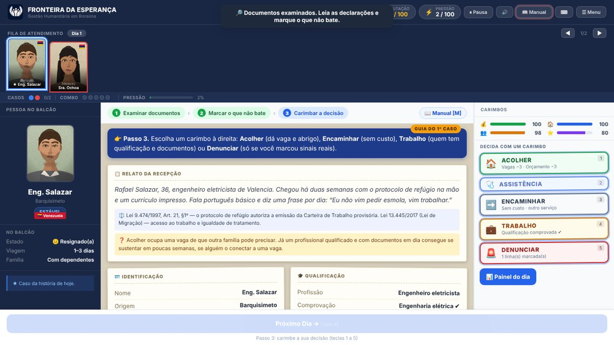
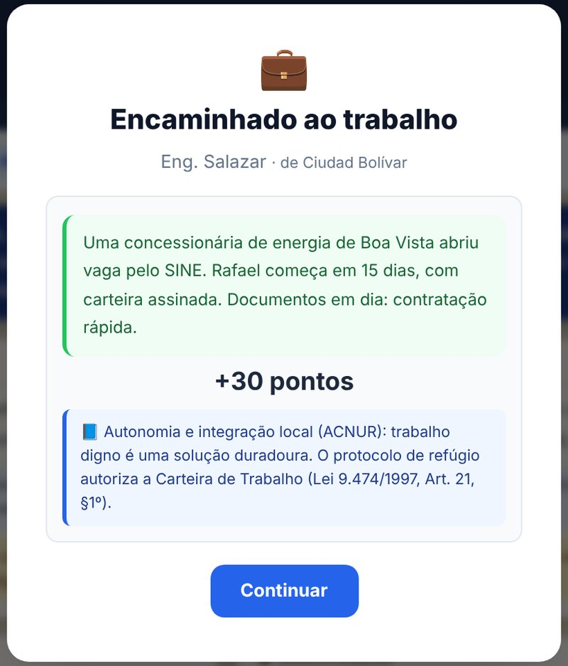
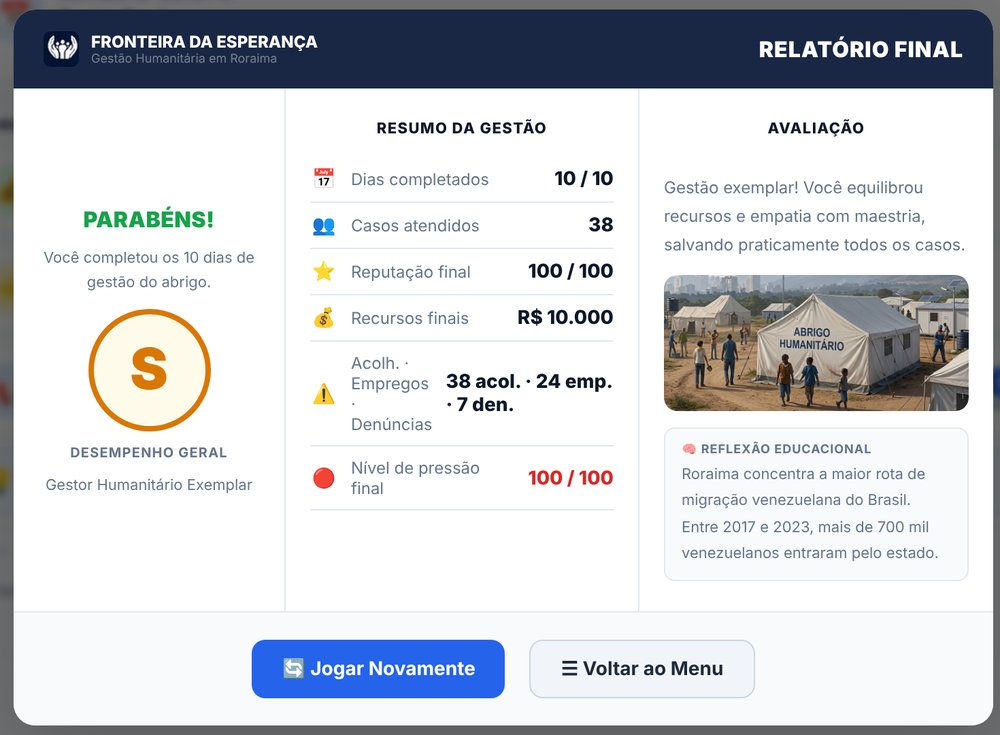

# Fronteira da Esperança

**Jogo sério de gestão humanitária sobre a migração venezuelana em Roraima.**

Você é um(a) técnico(a) recém-contratado(a) do Abrigo Esperança, em Boa Vista (RR). Durante 10 dias, atende imigrantes e refugiados venezuelanos no balcão: examina documentos, percebe sinais de exploração e decide, com recursos limitados, quem acolher, a quem prestar assistência, quem encaminhar, quem orientar para o trabalho e quando denunciar.

O jogo foi desenvolvido como Trabalho de Conclusão de Curso (TCC) em Ciência da Computação na Universidade Federal de Roraima (UFRR).

**▶ Jogar no navegador:** https://mateusmoraes99.github.io/fronteira-da-esperanca/

<p align="center">
  
  
</p>

---

## Sumário

- [Sobre o jogo](#sobre-o-jogo)
- [Como executar](#como-executar)
- [Estrutura do repositório](#estrutura-do-repositório)
- [Desenvolvimento](#desenvolvimento)
- [Testes](#testes)
- [Documentação](#documentação)
- [Pesquisa](#pesquisa)
- [Autoria](#autoria)

---

## Sobre o jogo

| | |
|---|---|
| **Gênero** | Jogo sério (*serious game*) de gestão e decisão, no estilo "balcão de atendimento" |
| **Duração** | Uma partida de 10 dias |
| **Plataforma** | Navegador (computador, tablet ou celular), sem instalação |
| **Idiomas** | Português e espanhol |
| **Conteúdo** | 25 casos, 10 capítulos de história, 10 eventos de crise e 10 melhorias |

### O que o jogador faz

1. **Examina os documentos** de cada pessoa (identificação, qualificação e declarações).
2. **Marca o que não bate**: declarações que indicam risco, como promessa de emprego sem contrato ou documento retido por outra pessoa. Pobreza, sotaque e nervosismo **não** são sinais de crime.
3. **Carimba uma decisão**:

| Carimbo | Efeito |
|---|---|
| ✅ **Acolher** | Dá vaga e abrigo. Custa orçamento, vagas e equipe; dá os pontos inteiros. |
| 🤝 **Assistência** | Comida, higiene e orientação. Metade do custo e metade dos pontos. |
| ➡️ **Encaminhar** | Sem custo, para outro serviço. Em casos críticos, a pessoa pode ser perdida. |
| 💼 **Trabalho** | Para quem tem qualificação e documentos. Gera autonomia e devolve recursos. |
| 🚨 **Denunciar** | Aciona a rede de proteção. Só funciona se houver sinais reais marcados. |

Após cada decisão o jogo mostra a consequência para a pessoa, a base legal (Lei de Migração, Lei do Refúgio, ECA, Protocolo de Palermo etc.) e um gabarito da conferência. Ao final, um relatório dá uma nota de **S** a **D**, combinando pontos e **conduta**.

<p align="center">
  
  
</p>

---

## Como executar

O jogo é **um único arquivo HTML**, sem dependências e sem servidor.

- **Online:** acesse o link do GitHub Pages acima.
- **Local:** baixe o arquivo [`index.html`](index.html) e abra no navegador (Chrome, Edge, Firefox ou Safari).

O progresso e os recordes ficam salvos no próprio navegador (LocalStorage), separados por idioma.

**Controles**: o jogo é todo jogável com mouse ou toque. No teclado: `E` examina, `1` a `5` carimbam, `←` `→` trocam a pessoa, `M` abre o manual, `P` pausa e `Espaço` fecha o dia.

---

## Estrutura do repositório

```
fronteira-da-esperanca/
├── index.html               ← jogo pronto (gerado pelo build; é o que o GitHub Pages publica)
├── src/
│   ├── jogo.js              ← código-fonte do jogo, comentado (único código do jogo)
│   ├── index.template.html  ← HTML e CSS da página, com marcadores para o build
│   └── assets/              ← logotipo e imagem do abrigo
├── i18n/
│   ├── traduzir.js          ← gera a versão em espanhol a partir de src/jogo.js
│   └── es/                  ← dicionários português → espanhol
├── tools/
│   └── build.js             ← monta o index.html e o pacote do itch.io
├── testes/                  ← testes técnicos automatizados (Playwright)
└── docs/                    ← documentação técnica e imagens
```

---

## Desenvolvimento

Requisitos: [Node.js](https://nodejs.org/) 18 ou superior.

```bash
npm install          # instala o acorn (tradução) e o Playwright (testes)
npm run build        # gera index.html e build/fronteira-da-esperanca-itchio.zip
```

O fluxo de trabalho é:

1. Editar o jogo em `src/jogo.js` (lógica e textos em português) ou em `src/index.template.html` (layout e estilos).
2. Se algum texto novo aparecer na tela, acrescentar a tradução em `i18n/es/` (veja [docs/TRADUCAO.md](docs/TRADUCAO.md)).
3. Rodar `npm run build` e abrir o `index.html` para conferir.
4. Rodar os testes (`npm test`).

> A versão em espanhol **não é editada à mão**: ela é gerada a cada build a partir do código em português, de modo que as duas versões nunca ficam diferentes nas regras.

---

## Testes

O jogo passou por uma avaliação técnica com **30 casos de teste**, 26 deles automatizados no Chromium com [Playwright](https://playwright.dev/):

| Tipo | Casos | Resultado |
|---|---|---|
| Funcionais | TF01 a TF15 | 15 passaram |
| Compatibilidade | TC01 a TC06 | 2 passaram, 4 dependem de execução manual |
| Localização (espanhol) | TL01 a TL06 | 6 passaram |
| Desempenho | TD01 e TD02 | 2 passaram |
| Regressão | TR01 | passou |

```bash
npx playwright install chromium   # apenas na primeira vez
npm test
```

Detalhes de cada caso, de como executar e dos resultados estão em [docs/TESTES.md](docs/TESTES.md).

---

## Documentação

| Documento | Conteúdo |
|---|---|
| [docs/ARQUITETURA.md](docs/ARQUITETURA.md) | Organização do código, estado da partida, ciclo de jogo e build |
| [docs/REGRAS.md](docs/REGRAS.md) | Recursos, custos, pontuação, conduta e cálculo da nota |
| [docs/TRADUCAO.md](docs/TRADUCAO.md) | Como funciona a versão em espanhol e como traduzir textos novos |
| [docs/TESTES.md](docs/TESTES.md) | Casos de teste técnicos e resultados |

---

## Pesquisa

A avaliação do jogo com participantes faz parte da pesquisa *"Desenvolvimento de um Jogo de Gestão Humanitária para Sensibilização sobre a Migração Venezuelana em Roraima"*, aprovada pelo Comitê de Ética em Pesquisa (CAAE 02414126.1.0000.5302).

Os casos do jogo são fictícios, inspirados em situações relatadas na literatura e na legislação sobre migração e refúgio no Brasil. Os nomes de pessoas são inventados.

---

## Autoria

**Mateus Moraes de Moura**: desenvolvimento e TCC  
**Prof. Dr. Luciano Ferreira Silva**: orientação  
Departamento de Ciência da Computação (DCC), Universidade Federal de Roraima (UFRR), 2026
