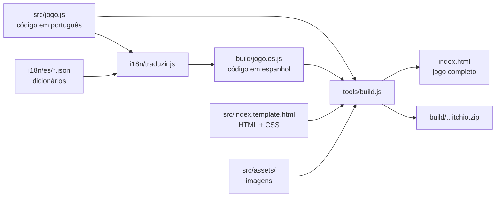
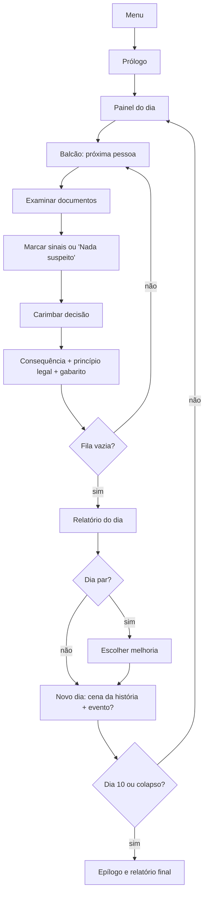

# Arquitetura

O Fronteira da Esperança é uma aplicação web estática: HTML5, CSS3 e JavaScript puro, sem frameworks e sem servidor. Tudo é entregue em **um único arquivo** (`index.html`, cerca de 850 KB), o que permite jogar offline, publicar no itch.io e no GitHub Pages sem configuração.

| Tecnologia | Uso |
|---|---|
| HTML5 + CSS3 | Interface responsiva (computador, tablet e celular) |
| JavaScript (ES2020) | Toda a lógica do jogo |
| SVG gerado por código | Retratos dos personagens (nenhuma imagem de pessoa é usada) |
| Web Audio API | Efeitos sonoros sintetizados na hora (sem arquivos de áudio) |
| LocalStorage | Partida salva, recordes, opções e idioma |
| Node.js (só no build) | Tradução para o espanhol e montagem do arquivo final |
| Playwright (só nos testes) | Testes automatizados no Chromium |

## Do código-fonte ao jogo



Dentro do `index.html`, os dois roteiros ficam guardados como `<script type="text/plain" id="game-pt">` e `id="game-es"`, que o navegador **não executa**. Um pequeno carregador no fim da página:

1. lê o idioma salvo (`localStorage.fronteira_lang`, padrão `pt`);
2. em espanhol, traduz os textos fixos do HTML com o dicionário `interface.json`;
3. executa apenas o roteiro do idioma escolhido.

Trocar de idioma no menu grava a escolha e recarrega a página.

## Organização de `src/jogo.js`

O jogo cresceu em versões (v12 a v21). Em vez de reescrever funções, cada versão **estende** a anterior:

```js
var _decidirBase = decidir;          // guarda a versão anterior
decidir = function (acao, forcar) {  // redefine
  _decidirBase(acao, forcar);        // mantém o comportamento antigo
  /* ... e acrescenta regras novas ... */
};
```

Por isso algumas funções aparecem mais de uma vez no arquivo; vale a última definição, que chama as anteriores. Os blocos, na ordem em que aparecem:

| Bloco | Conteúdo principal |
|---|---|
| Dados | `CASOS` (25 casos), `UPGRADES` (10 melhorias), `EVENTOS` (10 eventos de crise) |
| Estado e regras básicas | `G`, `fila`, `gerarFila`, `decidir` (acolher, assistência, encaminhar) |
| Persistência | `salvarJogo`, `carregarJogo`, `salvarRecord`, `OPTS` |
| Controlador v14 | Sons, HUD, painel do dia, avanço de dia, nota final (`encerrarJogoV14`) |
| v16 · Caderno | `META` (profissão, documentos, alertas), `decidirNova` (examinar, trabalho, denúncia), `PRINC` |
| v16 · História | Motor de cenas (`mostrarCena`), `CAPITULOS`, `CENAS`, `epilogo` |
| v17 · Balcão | Papéis lacrados, declarações (`CASO_LINHAS`, `DECOYS`), marcação de sinais, carimbos |
| v18/v19 · Retratos | `PERFIL` e funções que desenham o rosto em SVG |
| v20 · Clareza | Guia do primeiro caso e resumo de uma frase da conferência |

## Estado da partida

Todo o estado fica no objeto global `G`, que é exatamente o que vai para o save:

```js
G = {
  dia: 1, maxDia: 10,
  res: { orcamento: 100, abrigo: 100, equipe: 100, reputacao: 80 },
  pts: 0, combo: 0,
  acolhidos: 0, encaminhados: 0, perdidos: 0,
  empregos: 0, denOk: 0, denErr: 0,   // v16
  etica: 50,                           // conduta
  // ...efeitos de melhorias (desconto, encSalvo, bonusPts, shieldLegal...)
};
```

Outras variáveis globais: `sel` (pessoa no balcão), `fila` (pessoas do dia) e `timers` (cronômetros dos casos urgentes).

## Ciclo de uma partida



As regras numéricas de cada etapa estão em [REGRAS.md](REGRAS.md).

## Persistência

| Chave do LocalStorage | Conteúdo |
|---|---|
| `fronteira_save` / `fronteira_save_es` | Partida em andamento, salva no início de cada dia |
| `fronteira_records` / `fronteira_records_es` | 5 melhores pontuações |
| `fronteira_opts` | Opções (dificuldade, cronômetro, leis, animações, consequências) |
| `fronteira_lang` | Idioma escolhido (`pt` ou `es`) |

As chaves com `_es` são criadas automaticamente na tradução, para que partidas em idiomas diferentes não se misturem.
