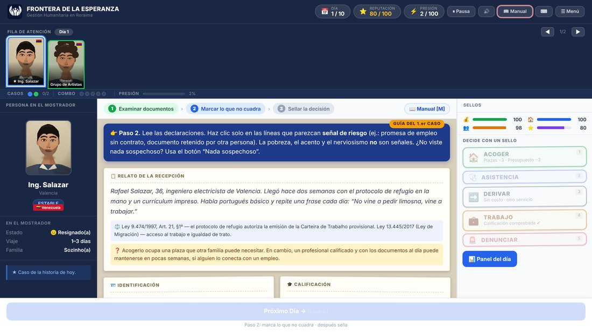

# Versão em espanhol

O jogo pode ser jogado em português ou em espanhol, escolhendo o idioma no menu inicial. A versão em espanhol existe porque o público retratado é formado por imigrantes venezuelanos: ela permite que hispanofalantes, inclusive equipes de acolhimento bilíngues, joguem no próprio idioma.



## O que é traduzido

Tudo o que aparece na tela: menu, opções, manual, os 25 casos, declarações, cenas da história, eventos, melhorias, consequências, princípios e relatórios.

Ficam em português, com explicação em espanhol, os nomes de leis e órgãos brasileiros (Carteira de Trabalho, CONARE, Polícia Federal, CRAS, Operação Acolhida). Os valores continuam em reais, porque o abrigo fica no Brasil.

## Como funciona

A tradução **não é uma cópia mantida à mão**. A cada build, o script [`i18n/traduzir.js`](../i18n/traduzir.js) gera o código em espanhol a partir de `src/jogo.js`:

1. O código é analisado com o parser [acorn](https://github.com/acornjs/acorn), que localiza cada string e *template literal*.
2. Só entram os textos exibidos ao jogador; nomes de classes CSS, medidas e código são ignorados.
3. Cada texto é procurado nos dicionários e substituído, mantendo o tipo de aspas e as tags HTML.
4. As chaves de save e recordes ganham o sufixo `_es`.
5. O resultado é validado pelo parser antes de ser gravado.

Assim as regras são sempre idênticas nos dois idiomas: só mudam os textos.

## Dicionários (`i18n/es/`)

| Arquivo | Formato | Uso |
|---|---|---|
| `textos.json` | `"texto em português": "texto en español"` | Strings do código |
| `templates.json` | `"template": [["trecho pt", "trecho es"], ...]` | Template literals com `${...}` |
| `extras.json` | `"texto": "texto"` | Strings curtas que o detector não reconhece como texto (rótulos em maiúsculas, trechos com `px` etc.) |
| `interface.json` | `"texto": "texto"` | Textos fixos do HTML (`src/index.template.html`) |

## Como traduzir um texto novo

1. Escreva o texto em português em `src/jogo.js` normalmente.
2. Acrescente a tradução ao dicionário certo, usando o texto em português **exatamente igual** como chave:

   ```json
   "Nova mensagem para o jogador.": "Nuevo mensaje para el jugador."
   ```

3. Rode `npm run build`. O script informa quantos textos foram substituídos e se houve problema (por exemplo, tags HTML diferentes entre o original e a tradução).
4. Rode a varredura `node testes/scan_es.js`: ela joga uma partida inteira em espanhol e lista em `testes/resultados/restos_portugues_es.json` os textos que ainda parecem estar em português.

Se o texto não estiver em nenhum dicionário, ele simplesmente aparece em português na versão em espanhol; o jogo não quebra.
